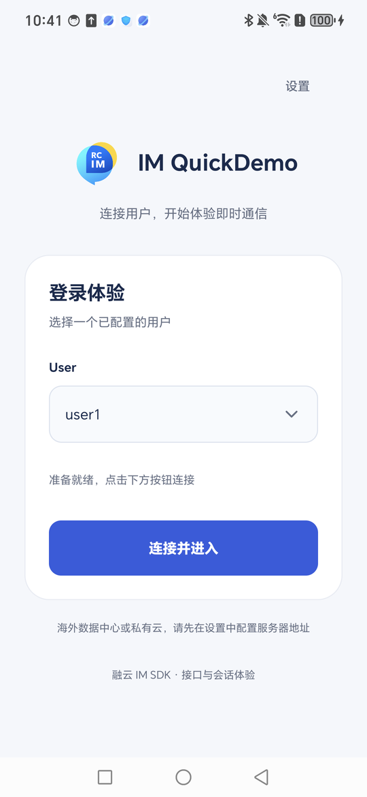
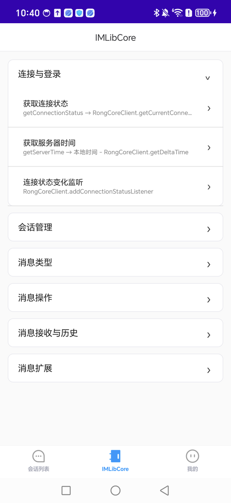
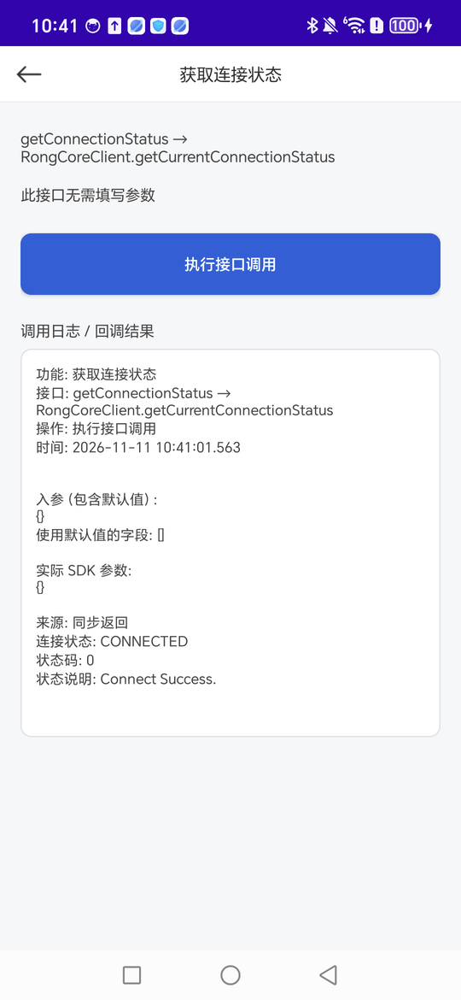
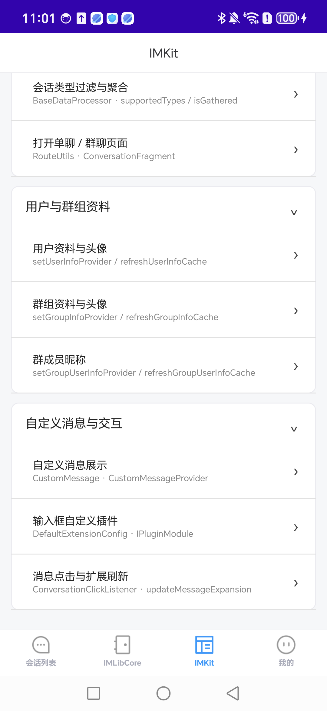
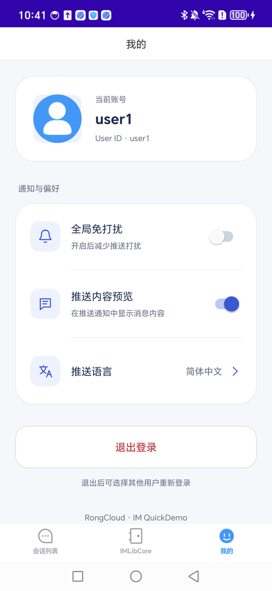

# IM QuickDemo · Android

基于融云 IM SDK 的 Android 示例工程，提供 **IMKit 会话体验**和 **IMLibCore 接口演示**。选择预配置用户登录后，可以按功能浏览接口、填写参数，直接查看 SDK 返回结果与错误码。

## 页面预览

以下为 Demo 的 Android 真机截图，使用示例账号 `user1`。点击图片可查看原图。

| 用户登录 | IMLibCore 接口目录 | 接口调用结果 | IMKit 场景目录 | 我的 |
| :---: | :---: | :---: | :---: | :---: |
| <a href="docs/images/login.png"></a> | <a href="docs/images/api-catalog.png"></a> | <a href="docs/images/api-result.png"></a> | <a href="docs/images/imkit-catalog.png"></a> | <a href="docs/images/profile.png"></a> |

截图中的连接状态是拍摄时的实际返回值，不代表全部接口已完成联网验证。截图为历史版本，部分底部导航及状态栏样式与当前版本不同。

## 功能概览

- **会话列表**：复用 IMKit 会话和聊天界面，支持自定义消息与插件。
- **IMLibCore**：79 个演示入口，按八个功能组组织；二级列表进入独立接口页面。
- **IMKit**：独立折叠目录，展示会话列表与聊天、用户/群组资料、自定义消息与交互，共 9 个场景。
- **我的**：账号信息、全局免打扰、推送内容预览、推送语言选择与退出登录。页面选项保留；当前未接入离线推送组件，语言选择仅保存为本地配置。

| 接口分组 | 示例能力 |
| --- | --- |
| 连接与登录 | 获取连接状态、估算服务器时间、连接状态监听及断开/重连 |
| 会话管理 | 会话分页、全部 channel 查询、置顶、免打扰、草稿、未读数 |
| 消息类型 | 18 项：文本、@、图片、GIF、语音、文件、视频、位置、富文本、合并、引用、定向、自定义及类型注册；图片/文件/视频区分已上传与 SDK 上传 |
| 消息操作 | 撤回、删除、清理历史、修改内容/状态、本地插入 |
| 消息接收与历史 | 接收监听、本地历史、远端历史、第一条未读、指定类型历史、按 UID 查消息、消息计数、未读 @ 消息、按时间设已读 |
| 消息回执与状态 | 单聊已读、群回执请求/新旧响应及监听、多端阅读同步、输入状态 |
| 会话消息搜索 | 关键字搜索会话、会话内消息搜索、时间段搜索、指定消息类型搜索、SearchMessageParams 本地组合搜索 |
| 消息扩展 | 发送支持扩展的文本消息、更新/删除扩展、扩展事件监听 |

完整接口和参数定义见 [ApiCatalog.java](app/src/main/java/cn/rongcloud/um/ui/api/ApiCatalog.java)。

## 快速开始

### 1. 准备环境

| 项目 | 配置 |
| --- | --- |
| Android Studio | 使用支持 Android Gradle Plugin 9.2.0 的版本 |
| Gradle JDK | 17 |
| Gradle Wrapper | 9.4.1，见 [gradle-wrapper.properties](gradle/wrapper/gradle-wrapper.properties) |
| Android Gradle Plugin（AGP） | 9.2.0，见 [build.gradle](build.gradle) |
| minSdk / compileSdk / targetSdk | 23 / 36 / 34 |
| Java 源码 / 字节码版本 | Java 8 |
| 融云 IMLib / IMKit | 5.48.0，见 [app/build.gradle](app/build.gradle) |

用 Android Studio 打开工程根目录，在 SDK Manager 中安装 **Android SDK Platform 36**，将 Gradle JDK 设置为 JDK 17，然后执行 Gradle Sync。命令行构建时也应将 `JAVA_HOME` 指向 JDK 17；源码的 Java 8 编译设置与运行 Gradle 的 JDK 版本相互独立。

当前工程已移除融云及厂商推送组件依赖、厂商参数配置和华为 AG Connect 插件，不提供离线推送接入示例，也无需配置 `agconnect-services.json`。如需离线推送，请按[融云 Android 文档](https://docs.rongcloud.cn/android-imlib/)另行接入。

统一使用工程自带的 `./gradlew`，无需单独安装 Gradle。Wrapper 当前从华为云镜像下载 Gradle 9.4.1；首次同步需要联网下载构建工具与依赖。

`settings.gradle` 的 `dependencyResolutionManagement.repositories` 中需保留 `google()`，用于解析 AndroidX、Data Binding 和 Material；仅在插件仓库中配置 `google()` 无法替代应用依赖仓库。

### 2. 配置 AppKey 和用户

在 [DemoConfig.java](app/src/main/java/cn/rongcloud/um/config/DemoConfig.java) 中填写自己的配置：

```java
public static final String APP_KEY = "你的 AppKey";

public static final List<User> USERS = Collections.unmodifiableList(Arrays.asList(
        new User("user1", "user1 对应的 Token"),
        new User("user2", "user2 对应的 Token")
));
```

- AppKey 从[融云开发者控制台](https://developer.rongcloud.cn/)获取，Token 从自己的服务端或控制台预先获取。
- 所有 Token 必须由该 AppKey 对应的应用签发，并与同一行的 User ID 对应。
- 增删 `USERS` 条目即可调整登录下拉框；修改配置后重新编译运行。
- 登录页只选择 User，不提供 AppKey、Token 输入框。客户端不配置 App Secret，也不调用服务端 HTTP API 获取 Token。

代码中配置凭据用于 Demo 体验；请勿将真实 Token 提交到公开仓库，正式应用应由业务服务端完成鉴权。

### 3. 运行并登录

选择 Android 设备运行 `app`，在登录页选择用户，点击“连接并进入”。SDK 返回成功后进入首页；失败时页面显示错误码。

海外数据中心或私有云需先通过登录页右上角的“设置”配置导航和文件服务器。SDK 初始化后修改服务器配置，需要重启应用生效。

## 如何体验接口

1. 登录后进入中间的 **IMLibCore** Tab，展开功能分组。
2. 点击二级条目进入接口页，按字段提示填写参数。`targetId` 必填，留空会提示错误，不使用当前用户 ID 作为默认值；其他字段留空时使用已声明的默认值，必填项会校验。
3. 点击执行，在结果卡片中查看有效参数、默认值、回调数据及错误码。
4. 再次执行时清除上一次的日志。密集回调合并刷新，超过 64K 字符时显示截断提示并保留最新内容。

分页获取会话列表只需要会话类型、时间和数量；具体字段以选中的 SDK 接口为准。图片、文件等接口支持从系统文件选择器导入本地文件。

消息类型组按文本、@、已上传图片、SDK 上传图片、GIF、语音、高清语音、已上传文件、SDK 上传文件、已上传视频、SDK 上传视频、位置、富文本、合并、引用、定向、自定义、注册的顺序展示。页面同时标明 Android SDK 实际方法；GIF、高清语音、文件、视频和合并上传使用 `sendMediaMessage`，定向发送使用 `sendDirectionalMessage`。已上传图片、语音、文件和视频统一填写线上 URL，通过 `sendMessage` 直接发送，无需本地文件或 SDK 上传；语音与视频填写时长，文件填写名称、大小和类型，视频填写大小。线上语音使用支持远端地址的 `HQVoiceMessage`，旧版 `VoiceMessage` 为 Base64 语音；合并消息选择聊天记录 HTML 文件并填写卡片摘要。

@ 消息遵循 [Android IMLib 发送消息文档](https://docs.rongcloud.cn/android-imlib/message/send)：支持普通群（3）和超级群（10），默认普通群，必须填写真实群 ID；单聊、聊天室等会话会在本地校验时拦截。`PART` 必填用户列表，`ALL` 可选填用户列表。IMKit 内置的 [@ 交互](https://docs.rongcloud.cn/android-imkit/features/message-mention) 仅支持普通群聊。

消息接收监听页面提供“开始 / 重新监听”和“停止监听”，展示消息及接收附加信息，离开页面移除本页监听。本地历史使用 `oldestMessageId`（默认 `-1`）分页；远端历史和指定类型历史使用时间戳。

会话消息搜索的 5 个页面均调用 `RongCoreClient`：`searchConversations`、按关键字的 `searchMessages`、按时间段的 `searchMessages`、按 `ConversationIdentifier` 与 `objectNames` 的 `searchMessages`、`searchMessagesWithParams`。均搜索本地已存储消息。会话搜索无需 `targetId`，三个指定会话搜索页必须填写 `targetId`；只有指定消息类型的重载接收 `channelId`（留空表示默认频道）。

内容搜索 `count` 默认 20，允许 0（全部结果）；`beginTime` 默认 0，从最新消息向前搜索。时间段搜索的起止时间使用毫秒，默认 0 到本次请求时间；`offset` 默认 0，`limit` 默认 20（页面支持 1–100）。

“搜索本地消息”通过 `SearchMessageParams` 组合关键字、排序（DESC / ASC）、分页、可选时间范围，以及会话类型、目标 ID、频道 ID、发送者 ID、消息类型过滤列表。`useTimeRange=false` 不传时间范围，过滤列表留空表示不限；可选 `targetIds` 不会默认填入当前用户。日志打印完整参数对象、`messages`、匹配总数 `matchCount` 及 SDK 错误码。

消息回执与状态按 11 项排列。Android 群回执请求/旧响应分别调用 `RongCoreClient.sendReadReceiptRequest` / `sendReadReceiptResponse`，V2 响应调用 `ReadReceiptV2Manager.sendReadReceiptResponse`，需要 AppKey 支持对应版本。先按 UID 加载本地消息，核对会话、频道和收发方向；旧版先请求后响应，V2 不依赖旧版请求流程。

单聊已读和多端阅读同步必须填写最后一条已读消息的 `sentTime`（毫秒），不默认使用当前时间。输入状态仅支持单聊，`sendTypingStatus` 返回 void 且约 6 秒限频，是否收到需在对端确认。监听页支持开始、重设、停止，离开页面自动释放；通过 IMKit 分发器和保留原监听的 V2 分发器接入，日志展示实际参数、完整回调和 SDK 错误码。

验证流程：两名用户加入同一普通群，发送者先发消息并保存 UID；接收者开启群请求监听，发送者发起旧版请求；接收者按 UID 响应，发送者在群响应监听页面观察结果。V2 需使用已启用 V2 的 AppKey；多端同步则使用同一账号的另一客户端观察。调用输入状态后需间隔约 6 秒再次测试。离开监听页面再返回时需重新开启监听。

连接状态监听页提供“设置监听 / 断开连接 / 连接”按钮；离开监听页面后移除本页监听，返回需重新设置。实际应用建议在 SDK 初始化后统一注册连接状态监听。

“获取服务器时间”使用本地时间减去 `getDeltaTime()` 估算，依赖 SDK 最近同步的时间差，并非实时请求服务器时间。

## IMKit 场景体验

底部四个 Tab 依次为：**会话列表 / IMLibCore / IMKit / 我的**。

| 分组 | 场景与操作 |
| --- | --- |
| 会话列表与聊天 | 查看会话列表与未读角标、配置过滤/聚合、填写目标 ID 打开单聊或群聊 |
| 用户与群组资料 | 填写用户/群组名称和头像、群成员昵称，刷新本机 IMKit 资料缓存 |
| 自定义消息与交互 | 查看自定义气泡、通过输入框插件发送示例消息、点击消息更新扩展并刷新气泡 |

每项都有独立说明页面、代码位置和操作入口。资料刷新仅更新本机缓存；打开群聊不会创建群或加入群。自定义消息需进入聊天页手动点击插件发送。顶部页面预览中的 IMKit 截图展示了目录展开并滚动后的效果。

IMKit 注册集中在 [ImKitDemoSetup](app/src/main/java/cn/rongcloud/um/sdk/ImKitDemoSetup.java)，场景目录在 [ImKitCatalog](app/src/main/java/cn/rongcloud/um/ui/kit/ImKitCatalog.java)。

## 可选配置

- **会话列表参数**：在设置页选择显示与聚合的类型。默认显示单聊、群聊和系统会话，聚合系统会话；这是本地列表配置，与接口演示页的 `conversationType` 入参独立。
- **登录状态**：`LoginSession` 在内存中保存已登录身份与 Token，仅持久化上次选择的 User ID；退出登录清空凭据。演示页临时断开连接保留凭据，供重连使用。

## 代码导航与扩展

接口演示采用轻量分层，普通 SDK 调用集中在领域 Actions 中，多步操作按需拆为 UseCase。

```text
ApiDetailActivity + ApiFormView
              ↓
          ApiSession
              ↓
           ApiRunner
              ↓
       ApiActionRegistry
              ↓
       Actions / UseCase
              ↓
       ApiContext → SDK
```

| 入口 | 职责 |
| --- | --- |
| [DemoConfig](app/src/main/java/cn/rongcloud/um/config/DemoConfig.java) | AppKey 与 User/Token 列表 |
| [SdkInitializer](app/src/main/java/cn/rongcloud/um/sdk/SdkInitializer.java) | 进程内初始化 SDK、注册消息、插件与路由 |
| [LoginController](app/src/main/java/cn/rongcloud/um/auth/LoginController.java) | 登录流程、重复点击与过期回调隔离 |
| [LoginSession](app/src/main/java/cn/rongcloud/um/auth/LoginSession.java) | 当前身份及凭据管理 |
| [ApiCatalog](app/src/main/java/cn/rongcloud/um/ui/api/ApiCatalog.java) | 接口 ID、分组、说明和参数 |
| [ApiActionRegistry](app/src/main/java/cn/rongcloud/um/ui/api/ApiActionRegistry.java) | API ID 与执行动作绑定，检查遗漏或重复注册 |
| [ApiSession](app/src/main/java/cn/rongcloud/um/ui/api/ApiSession.java) | 请求生命周期、结果展示与回调隔离 |

新增普通接口：添加目录项及参数，在对应 `*Actions` 中实现方法并注册。只有查询、校验、执行等多步流程才需要独立 UseCase。详细约定见[架构说明](docs/architecture.md)。

## 构建与检查

```bash
# 查看 Wrapper 和实际使用的 JVM 版本
./gradlew --version

# 生成 Debug APK
./gradlew :app:assembleDebug

# 单元测试与静态检查
./gradlew :app:testDebugUnitTest :app:lintDebug
```

APK 输出：`app/build/outputs/apk/debug/app-debug.apk`。

单元测试覆盖登录回调隔离、参数校验、接口注册完整性和监听生命周期等。构建、单元测试及 Lint 不能替代有效账号、网络和设备上的 SDK 联调。
